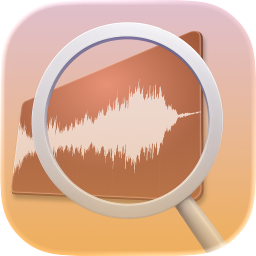

<h1 align="center">
  
  <br>
  WaveSearch
</h1>

<p align="center">
  Find, preview, and bring sound effects into your edit.
  <br>
  A native macOS app powered by a portable Zig and SQLite core.
  <br>
  <a href="#about">About</a>
  ·
  <a href="#build">Build</a>
  ·
  <a href="#using-wavesearch">Usage</a>
  ·
  <a href="#documentation">Documentation</a>
  ·
  <a href="CHANGELOG.md">Changelog</a>
  ·
  <a href="#developing">Developing</a>
</p>

## About

WaveSearch searches your sound effect libraries where they already live. Add a
folder, find a sound, preview its waveform, and drag it into your DAW or video
editor. Imports reference the original file by default; copying media is an
explicit choice in Settings.

The SwiftUI/AppKit macOS interface connects to `libwavesearch`, a Zig core for
indexing, SQLite FTS5 search, audio analysis, acoustic fingerprints, and optional
local CLAP semantic search.

- **Search your libraries.** Search filenames and WAV/MP3/FLAC/Ogg metadata,
  filter by duration or UCS category, browse folders, and keep favourites.
- **Preview and compare.** Play audio, seek through channel waveforms, inspect
  loudness, and find similar sounds or duplicate families.
- **Keep working while indexing.** Searchable snapshots appear before optional
  background refinement finishes.
- **Keep control of your files.** Choose original-file imports or persistent
  copies, and manage catalog backups, recovery, and waveform caches in Settings.

The first version is **0.1_alpha**. Later changes are recorded under
[Unreleased in the changelog](CHANGELOG.md#unreleased).

## Build

### Requirements

- macOS 14 or later for the desktop app.
- Xcode 26 or later for the app and Swift checks.
- Zig 0.17.0, pinned in [.zig-version](.zig-version).

Build from the repository root:

```bash
make build   # Build the Zig core and macOS app
make core    # macOS XCFramework, or the native core library on Linux
make macos   # Full macOS debug build, including the core
```

You can also open [wavesearch.xcodeproj](macos/WaveSearch/wavesearch.xcodeproj)
in Xcode and press **Command–R**. Its pre-build phase rebuilds the core before
linking the Swift app. Local builds use ad-hoc signing and need no developer
account.

Signed, notarized DMGs use the separate [release workflow](documentation/RELEASING.md)
with an explicitly chosen version/commit and Developer ID credentials. It does
not change normal builds or publish a GitHub release automatically.

The macOS core build compiles arm64 and x86_64 libraries, combines them with
`lipo`, creates `WaveSearchKit.xcframework`, and copies it into the app sources.
SQLite is vendored; `build.sh` downloads the amalgamation only if it is missing.
Normal builds never download semantic models or ONNX Runtime.

For the portable core on macOS or Linux:

```bash
cd core
zig build test -Doptimize=safe
zig build lib -Doptimize=safe
```

The `xcframework` build step requires a macOS host. Linux currently has a core
library and checks; Linux and Windows desktop apps are future work.

## Using WaveSearch

1. Click **+** in the sidebar to add a library folder.
2. Search as soon as the initial snapshot is available. Choose **Fast only**,
   **Balanced**, or **Complete** refinement in the top-right status popover.
   Balanced waits until the Mac is idle and on AC power.
3. Select a result to preview it. Click the waveform to seek, or press
   **Space** to play/pause when the search field is not focused.
   Drag to select a range or set **i / o** at the playhead; **Return** plays
   from its in point and stops at its out point. The preview panel offers
   **Loop**, **Rate** (0.5×–2×) and **Clear Range** controls.
4. Drag a result into your editor. To drag a waveform range, select it first,
   release the mouse, then drag from inside the selection.
5. Open **Settings → General** to choose how editor imports handle files:
   **Keep the files in place** passes the full original file, including when
   dragging a selected range; trimming and any editor-managed copies happen in
   your editor. **Copy files to Exports** copies whole files unchanged and
   renders partial selections as trimmed PCM24 WAVs in a persistent folder.

Use **Library → Tags, Collections & Favourites…** to add tags, save sounds or
preview ranges into named collections, and import/export your selects as JSON.
**Browse** opens a tag, collection or favourites in results. Unresolved references
are retained and can be linked explicitly after adding/reconnecting a library.
See [portable selects](documentation/PORTABLE_SELECTS.md).

The interface follows your macOS app language in English or Spanish. Set a
per-app language in System Settings → General → Language & Region and reopen
WaveSearch. This changes interface text; filenames and search terms stay intact.

Right-click a result to find similar sounds, manage favourites and collections, or reveal the
source in Finder. The waveform search icon beside the search field lets you
choose an audio file as a search example; you can also drop one onto the search
bar. WAV/AIFF examples use the core decoder. Other formats use macOS audio
decoding when available and must fit within 60 seconds and 64 MiB of decoded
Float32 PCM. Examples are temporary search inputs and are not imported into
the catalog. Type a query or use the clear button to leave example search.

Right-click a library to re-index, remove, or reconnect a moved folder. If a
drive disconnects, the library shows **Missing drive** and its indexed files
remain searchable.

Libraries update automatically as files change. Turn **Keep libraries up to
date** off in **Settings → General → Library changes** to scan manually.
Verified, unambiguous moves within a library keep favourites and existing
analysis. Older files without a complete-byte identity and ambiguous duplicates
may receive new IDs; see [library reconciliation](documentation/LIBRARY_RECONCILIATION.md)
for the policy and verification limits.

**Settings** also provides preview volume and background refinement controls,
system/light/dark appearance, accent and waveform colors, catalog backup and
restore, integrity checks, storage sizes, and generated waveform cache deletion.
Exported media remains available because editing projects may reference it.
**Settings → General → Audio preview** also offers **Autoplay selected sounds**,
off by default. Playback waits for the newest selected file to finish preparing.
Rate and loop settings affect preview only; selections reset when files change.

In **Settings → General**, enable a global search shortcut to bring WaveSearch
forward and focus search from another app. Choose from the listed combinations;
the shortcut is off by default and works while WaveSearch is running. See the
[macOS integration notes](documentation/MACOS_INTEGRATION.md) for conflicts and
verification limits.

The indexing status popover shows recent processing speed and estimated active
processing time separately for waveforms, acoustic fingerprints, and semantic
embeddings. Estimates warm up during each session and suspend while blocked.
They exclude pauses and other queues; Balanced mode cannot promise a finish time.

### Keyboard shortcuts

| Shortcut | Action |
| --- | --- |
| **⌘K** or **/** | Focus search |
| **⌃⌘S** | Show/hide the sidebar |
| **⌘,** | Open Settings |
| **Esc** | Move from search to results; from results back to search |
| **Tab / ⇧Tab** | Move between native controls |
| **j / k** or **↓ / ↑** | Next / previous result |
| **gg / G** | First / last result |
| **Return** | Play the selected result from the in point |
| **Space** | Play/pause outside text input |
| **h / l** | Shuttle backward / forward; repeat to accelerate |
| **i / o** | Set in / out points |
| **b** | Reveal the selected file in Finder |
| **⌘⇧C** | Copy the selected sound/range for an editor, using the import preference |
| **⌘⇧O** | Add a library |
| **?** or **⌘?** | Open keyboard shortcut help |

Bare preview keys work when results have focus; text editing and other focused
controls keep their normal keys. Use **Help → Keyboard Shortcuts** for the
in-app reference. The **Preview position** slider supports keyboard/VoiceOver
seeking before setting **In / Out** points. **Copy for Editor** provides a file
URL to paste into compatible editors; keep-in-place mode supplies the full
original even for a range. The **Library** menu provides selected-library
management. See [accessibility workflows and verification limits](documentation/ACCESSIBILITY.md).

Use **UCS Categories** beside search to filter recognized filename categories,
including counts for the selected library. You can combine `cat:AIRBlow` with
text or duration. Unknown CatIDs stay uncategorized. Re-index older libraries
to refresh compressed descriptions and category facets. See
[metadata formats and limits](documentation/AUDIO_METADATA.md).

### Duration filters

| Search | Meaning |
| --- | --- |
| `whoosh <2s` | Shorter than two seconds |
| `riser >5s` | Longer than five seconds |
| `impact =1.5s` | Around 1.5 seconds |
| `click <500ms` | Shorter than 500 milliseconds |

Multiple duration filters intersect regardless of order. Equality allows
±250 milliseconds, and duration filters exclude files with unknown duration.

WAV metadata search includes `bext`, `iXML`, XMP and `LIST/INFO` before or after
audio data. UTF-8 descriptions remain searchable without XML tag noise.
Indexed WAV/AIFF technical metadata also avoids repeated native inspection while
browsing. See [metadata limits and cache behavior](documentation/AUDIO_METADATA.md).
Small English/Spanish vocabulary groups also connect terms such as
`whoosh`/`swoosh`/`swish`, `golpe`/`impact`, `lluvia`/`rain` and `puerta`/`door`.
Exact filenames keep priority. See [vocabulary and evaluation limits](documentation/LEXICAL_SEARCH.md).

## Optional semantic search

CLAP adds offline semantic search to the existing lexical and acoustic search.
On Apple silicon Macs, open **Settings → General → Optional semantic search**
to review the terms and start a download. The installer shows progress, supports
cancel/retry, and verifies files before activation. Allow 1.5 GB of free disk
space for the roughly 800 MB model pack and runtime. Nothing downloads at startup.

The CLI installer remains available:

```bash
./scripts/install-clap-model.sh
```

The pinned installer supports macOS arm64 and Linux x86_64. It installs the
verified `muzaiten/clap-htsat-base-onnx` pack and a dynamically loaded ONNX
Runtime. Lexical search remains available during installation and when the
provider is absent or cannot load. The pinned macOS runtime requires Apple silicon.

Built-in semantic indexing supports WAV and uncompressed AIFF/AIFC.
Host-decoded compressed audio can use the interleaved-PCM search API;
unsupported formats retain lexical indexing and search.

Read the [model setup and integrity contract](core/models/README.md) for paths,
environment variables, and limitations, and review
[third-party notices](THIRD_PARTY_NOTICES.md) before installing.

## Documentation

Start with the [documentation index](documentation/README.md), or go directly to:

- [Audio preview and editor imports](documentation/WAVEFORM_AND_AUDIO_PREVIEW.md).
- [Waveform algorithm](documentation/WAVEFORM_ALGORITHM.md) and
  [cache design](documentation/WAVEFORM_CACHE_V10.md).
- [Acoustic search and duplicate families](ACOUSTIC_SEARCH.md), including
  [bounded extraction, lossless storage, and exact byte identity](documentation/INDEXING_STORAGE_IDENTITIES.md).
- [Backup, recovery, and operations](OPERATIONS.md).
- [Search optimizations](documentation/SEARCH_OPTIMIZATION_RESULTS.md) and
  [benchmarks](BENCHMARKS.md), including measured results and validation limits.
- [Changelog](CHANGELOG.md) and [roadmap](ROADMAP.md).

## Developing

External hosts should follow the [C API compatibility and lifecycle contract](documentation/C_API.md)
for version/capability negotiation, ownership and worker draining.

The repository keeps the portable core and native frontend together:

```text
core/
  build.zig                 Native library, tests, benchmarks, macOS XCFramework
  include/wavesearch.h       Public C API
  src/                      Catalog, search, fingerprints, audio, waveform DSP
  vendor/                   SQLite and ONNX Runtime headers
macos/WaveSearch/
  wavesearch.xcodeproj       Xcode project
  WaveSearch/                SwiftUI interface and native platform adapters
  Tools/                    Swift checks and waveform benchmarks
scripts/                    Build support, checks, and opt-in installers
```

After editing Zig code, run `./build.sh` on macOS to refresh the XCFramework,
then run the app from Xcode. A clean checkout regenerates the frameworks;
build caches, personal Xcode state, and optional model/runtime artifacts are
ignored. `make clean` removes local build caches and output.

`make clean` also removes both generated XCFramework copies while preserving
DerivedData outside its Build directory. `make distclean` removes the selected
DerivedData directory too; use `DERIVED_DATA=/path/to/data` for a custom one.
Optional models, fixture downloads, personal Xcode state, and persistent media
are preserved. See the [repository audit](documentation/REPOSITORY_AUDIT.md)
for cleanup findings and intentionally retained files.

### Checks

```bash
make check                # Full core checks, app build and Swift checks on macOS
make check-core           # Portable formatting, script checks, tests, library build
make check-macos-headless # macOS build and lifecycle/policy checks without GUI tests
make check-macos-runtime  # Swift compilation and runtime checks without an Xcode app build
make check-linux          # Cross-compile the Linux x86_64 library and core checks
```

The macOS window and Settings checks require a logged-in desktop session and
an active display; they fail promptly when those prerequisites are unavailable.
Playback logic uses a controlled clock. Native output, ALAC and pasteboard checks
run when available and otherwise print explicit skips. To require all three, run
`bash scripts/test-app-lifecycle.sh --native-audio --native-codecs --native-pasteboard`.
`check-macos-runtime` can diagnose a host whose Xcode project initialization
fails, but does not replace app-bundle or desktop validation.
GitHub Actions runs native Linux core checks and macOS core/app/headless checks
on pushes and pull requests. See the [CI workflow and limits](documentation/CI.md).
Optional model downloads and benchmarks are separate from normal checks.
Use `make check ZIG=/path/to/zig` to select the pinned compiler explicitly.
Cross-compilation checks compatibility; run `make check-core` on Linux to
execute the portable tests there.

Read [AGENTS.md](AGENTS.md) before agent-assisted changes. It records coding
preferences, validation workflows, and the requirement to keep the changelog
and repository guidance current.

For platform work or changes to concurrency and resource scheduling, read the
[performance and portability plan](documentation/PERFORMANCE_AND_PORTABILITY_PLAN.md).
