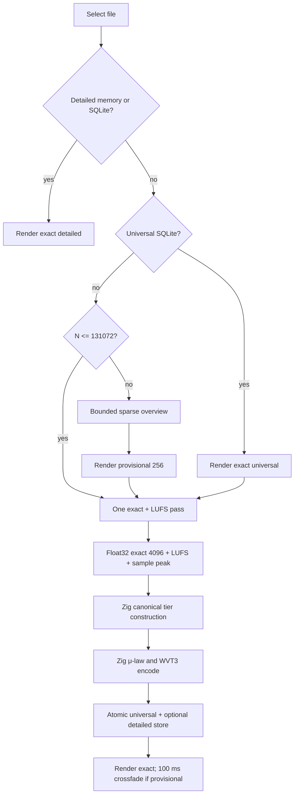

# Waveform algorithm reference

This document specifies waveform generation, quantization, loudness, staging,
and rendering in the current schema-v10 implementation. Storage and operational
details are in [`WAVEFORM_CACHE_V10.md`](WAVEFORM_CACHE_V10.md).

## 1. Requirements

The algorithm must provide:

- A usable first waveform within 50 ms p95 on the target uncached SSD path.
- A SQLite tier hit within 16 ms p95.
- An authoritative result in which every finite decoded PCM sample contributes.
- Independent left/right display peaks.
- Bounded first-display work, exact-analysis memory, cache bytes, and background
  concurrency.
- Stable playhead and selection fractions while data refines.
- Deterministic invalidation and no approximate persistent data.

No synchronous algorithm can both inspect every frame of an arbitrarily long
uncached recording and have duration-independent latency. WaveSearch therefore
uses a bounded provisional overview followed by one authoritative pass.

## 2. Definitions

Let:

```text
N  = AVAudioFile client-frame count
R  = processing sample rate
C  = source channel count
Cr = min(C, 2), displayed channels
B  = min(max(N, 1), 4096), detailed bucket count
```

A display peak is a signed pair:

```text
Peak = (minimum, maximum), minimum <= maximum
```

The authoritative contract consumes planar or interleaved Float32 PCM.
Non-finite samples are treated as zero. Decoding remains a host responsibility:
Swift uses AVFoundation (or its opt-in mapped PCM reader), while Linux hosts can
stream any decoded Float32 source through the same C ABI.

## 3. Source identity

Before decoding, WaveSearch captures:

- Standardized path used to open the source.
- File byte size.
- Nanosecond modification time.
- Indexed WaveSearch content identity.
- Analyzer revision.

The signature is captured again after decoding. Equality is required before
publication. SQLite also revalidates file ID, content identity, size, and mtime
inside the tier-store transaction.

WVT3 does not persist the absolute path, so a root relocation with unchanged
source identity can reuse tiers. The current path is supplied during decode.

## 4. Pipeline



For an existing universal tier, exact detailed generation follows only because
the selected/recent tier is missing. Background library work stores universal
only and uses a distinct 512-bucket profile. Compatible callers coalesce;
foreground selection cancels an incompatible background producer so two source
reads do not overlap.

## 5. Bounded sparse overview

For files above 131,072 frames, first-display constants are:

```text
windows             = 8
frames per window   = 2,048
segments per window = 8
output buckets      = 256
maximum decoded     = 16,384 frames
```

Let `F=2048`, `W=8`, and:

```text
maximumStart = max(0, N - F)
start(i) = floor(maximumStart * i / (W - 1)), i=0...W-1
```

Each window is divided into eight contiguous segments. For segment `j` with
`decoded` frames:

```text
localStart = floor(j * decoded / 8)
localEnd   = floor((j + 1) * decoded / 8)
```

The analyzer takes actual Float32 minimum and maximum in that segment for each
displayed channel. The anchor position is its global center:

```text
anchorFrame = windowStart + floor((localStart + localEnd) / 2)
anchorX = clamp(anchorFrame / N, 0, 1)
```

Eight windows produce up to 64 ordered anchors per channel. Preview bucket `b`
has center:

```text
x(b) = (b + 0.5) / 256
```

Minimum and maximum are linearly interpolated between surrounding anchors.
Outside the anchor range, the nearest anchor is used.

The overview derives only from real PCM but is not authoritative: an unsampled
transient may be missing. It has `fidelity = provisional`, no complete loudness,
and cannot pass WVT3 encoding guards.

Files at or below 131,072 frames skip sparse sampling. They publish exact
Float32 extrema immediately without waiting for K-weighting; a second small
loudness-only pass completes normalization and persistence. This deliberately
trades a tiny amount of short-file I/O for lower first-display latency.

## 6. One-pass authoritative analysis

The sequential reader supplies Float32 non-interleaved PCM in reusable 32,768
frame buffers. AVAudioFile remains the default and handles compressed formats.
A conservative mapped WAV/AIFF PCM reader is available behind
`WS_ENABLE_MAPPED_PCM=1` for cold-drive evaluation; unsupported layouts fall
back to AVFoundation. The pass maintains:

- Float32 minima and maxima for `B * Cr` buckets.
- One K-weighting filter state per source channel.
- 100 ms loudness segment energy.
- Absolute sample peak.

For absolute source frame `f`:

```text
bucket(f) = min(B - 1, floor(f * B / N))
```

Bucket runs are split at exact mathematical boundaries. Accelerate/vDSP computes
every run's minimum and maximum, with scalar sanitization only when a decoded
run contains NaN or infinity. For displayed channel `c`:

```text
minimum[c,b] = min(minimum[c,b], sample[c,f])
maximum[c,b] = max(maximum[c,b], sample[c,f])
```

On macOS, vDSP computes sample magnitude peaks, cascaded Double-precision
K-weighting, and 100 ms segment energy while preserving filter state across
chunks. Its highest-resolution Float32 extrema enter libwavesearch through
`ws_waveform_result_create_v1`; Zig then performs canonical μ-law, tier
construction, and WVT3 serialization. The portable alternative streams each
32,768-frame decoded chunk through `ws_waveform_analyzer_push_v1`, where Zig
computes the same extrema, sample peak, and loudness semantics. Thus either
backend requires one sequential source decode, not two full passes.

The v1 streaming lifecycle is `create -> push* -> finish -> destroy`; a result
returned by `finish` has independent ownership and its own destroy call. Push
copies PCM synchronously. Planar/interleaved pointers therefore remain borrowed
only for the duration of the call. Create, push, and finish are single-threaded;
cancel may be called from another thread, with destruction deferred until that
thread has joined. Null output plus zero capacity is a successful size query for
level copying and WVT3 serialization.

At EOF, decoded frame count must equal the reader's authoritative client-frame
extent. A premature zero-frame read fails rather than creating a false silent
tail. Source signature equality is then checked.

## 7. Universal reduction

The selected detailed level is at most 4,096 buckets. The universal target is
`min(512, B)`. Foreground reduction uses the range below. Background universal
work aggregates directly into 512 buckets and returns only that level; sources
shorter than 4,096 frames retain the legacy partition path so persisted bytes
remain identical. Universal bucket `u` covers detailed range:

```text
start = floor(u * B / U)
end   = max(start + 1, floor((u + 1) * B / U))
```

Reduction is:

```text
universal.minimum[u] = min(detailed.minimum[start..<end])
universal.maximum[u] = max(detailed.maximum[start..<end])
```

No RMS or averaging occurs, so any exact detailed transient remains represented
in the universal bucket that contains it.

For rendering a detailed tier, libwavesearch derives 512, 1,024, and 2,048
levels in memory with the same min/max reduction. Only the single universal and
single detailed levels are persisted.

## 8. Int8 μ-law quantization

Analysis compares extrema in Float32. Quantization occurs only after a bucket is
complete.

With `μ=255` and normalized finite sample `x`:

```text
clamped = clamp(x, -1, 1)
y = sign(clamped) * log(1 + μ * abs(clamped)) / log(1 + μ)
q = round(y * 127)
```

`q` is signed Int8 in `[-127,127]`; `-128` is forbidden. Zero maps exactly to
zero. Decode is:

```text
x' = sign(q) * (exp(abs(q)/127 * log(1+μ)) - 1) / μ
```

The transform is monotonic. Therefore independently encoded minima and maxima
remain ordered. μ-law gives substantially more codes to low amplitudes than
linear Int8, retaining quiet ambience while halving Float16 storage.

Fresh exact analysis immediately reconstructs display Float32 peaks from the
Int8 codes. Cache-hit rendering follows the same path, so persistence alone
cannot alter appearance.

Values above full scale are clamped for drawing and peak storage, but sample peak
is measured before clamping and remains available for gain safety.

## 9. Loudness

Loudness analysis requires `R >= 8000 Hz`; lower rates are rejected because the
K-weighting sections are not valid below that bound. Each channel uses a
high-frequency shelf followed by an RLB high-pass. Weighted
samples contribute squared energy. Mono/stereo channels use unity power weight;
common 5.1/7.1 order excludes channel 4 (LFE) and applies BS.1770 surround power
weight 1.41 to subsequent surround channels.

```text
segmentFrames = round(R * 0.1)
```

Four complete segments form a 400 ms block, advanced by one 100 ms segment.
Block power is total weighted energy divided by exact contributing frame count.
Short sounds without a complete block use all available frames with frame
weighting.

For power `P`:

```text
L(P) = -0.691 + 10 * log10(P)
```

Integrated loudness:

1. Discard blocks at or below -70 LUFS.
2. Average surviving powers.
3. Set relative gate to preliminary loudness minus 10 LU.
4. Discard blocks at or below that gate.
5. Convert final mean power to LUFS.

A rolling four-segment window avoids retaining all 100 ms segments. Absolute
blocks are accumulated into fixed 0.001 LU bins from -70 through +50 LUFS, with
per-bin power sums and counts. Relative gating therefore uses bounded memory
independent of recording duration. Silence returns no LUFS. Preview normalization uses:

```text
loudnessGain = clamp(-18 - integratedLUFS, -18, +18)
peakSafeGain = -1 - samplePeakDBFS
normalization = min(loudnessGain, peakSafeGain)
```

## 10. Tier codec

WVT3 contains exactly one peak level:

```text
magic, binary version, codec version, tier
analyzer version
size, mtime, content identity
sample rate, frame count, source channel count
bucket count, rendered channel count
integrated LUFS, sample peak
Int8 minimum/maximum bytes
64-bit payload checksum
```

A detailed decode derives lower levels in memory. A universal decode remains a
single level until selected-file detailed refinement completes.

Encoding requires:

```text
fidelity == exact
loudness.analysisComplete == true
```

Malformed dimensions, invalid tier/version, checksum mismatch, forbidden -128,
minimum greater than maximum, or trailing data reject the blob.

## 11. Cache and work state

Lookup order is:

1. Reconstructed detailed memory LRU.
2. Detailed SQLite tier.
3. Universal SQLite tier.
4. Sparse preview when needed.
5. Shared exact producer.

Universal tiers are retained for indexed supported files. Detailed tiers are
limited by both:

```text
configured bytes <= 512 MiB
file count <= 10,000
```

Default detailed bytes are 256 MiB. Eviction sorts by access nanoseconds then
file ID for deterministic ties. It clears only detailed columns.

Missing universal work is represented implicitly by indexed files without a
tier row. This is resumable without duplicating one queue row per file. Cursor
advance and a global tokenized claim are published in one immediate transaction.
The five-minute lease is renewed once per minute, explicitly released on
cancellation, and reclaimed after crash expiry. Permanent identity-scoped
failures are excluded until source identity changes; a token-stale worker cannot
publish a failure over a newer claim or completed tier.

## 12. Complexity

Let `Cr=min(C,2)` and `B<=4096`.

| Operation | Decoded frames | Complexity |
|---|---:|---:|
| Sparse overview | ≤16,384 | `O(16,384 * Cr)` |
| Exact waveform + LUFS | `N` once | `O(N * C + B * Cr)` |
| Universal reduction | 0 | `O(B * Cr)` |
| μ-law encoding | 0 | `O(B * Cr)` |
| Detailed tier bytes | 0 | `2 * B * Cr + header` |
| SQLite cache hit | 0 | `O(blob bytes)` |
| Canvas draw | 0 | `O(chosen level buckets * Cr)` |

Working PCM memory is chunk-bounded and independent of `N`.

## 13. Publication and cancellation

- Sparse and selected exact work use user-initiated priority.
- Library backfill is one-file-at-a-time background work.
- Repository exact tasks are keyed by complete source identity.
- Multiple subscribers await one task.
- UI cancellation removes publication interest without starting duplicate work.
- SQLite revalidates identity in the same transaction as publication.
- Provisional bytes are never stored.
- A 100 ms opacity crossfade occurs only from provisional to exact for the same
  source signature.
- Selection and playhead are independent state and keep their normalized
  timeline fractions.

## 14. Determinism and limitations

Window starts, bucket mapping, reductions, quantization, serialization, and LRU
tie-breaking are deterministic. AVFoundation decoder output can vary slightly
between operating-system implementations, so WVT3 is a local cache rather than
a cross-machine canonical audio fingerprint.

Only two channels are displayed, though all channels contribute to loudness.
The entire recording remains fitted; no sample-level zoom is provided. Int8
μ-law is visually compact but not a replacement for source PCM and is never
used for selected-range export.

## 15. Validation invariants

- μ-law encode/decode is monotonic and zero-preserving.
- `-128` is never emitted and is rejected on decode.
- Every exact source frame maps to one detailed bucket.
- Universal reduction contains detailed extrema.
- Stereo channels never mix.
- Fresh and cached exact rendering reconstruct from identical Int8 values.
- Provisional/loudness-incomplete data cannot encode.
- Stale identity cannot commit.
- Detailed eviction never removes universal data.
- One in-flight source identity has one authoritative decoder.
- Playback, search, thermal state, memory pressure, metadata scans, and user
  pause can stop background claims between files.
